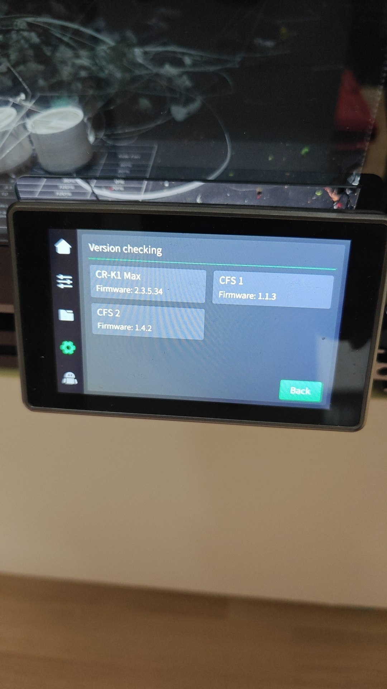
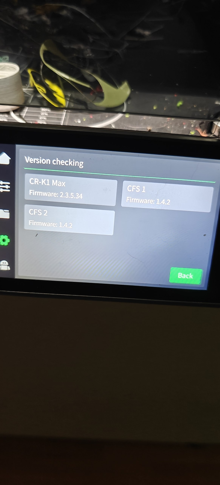
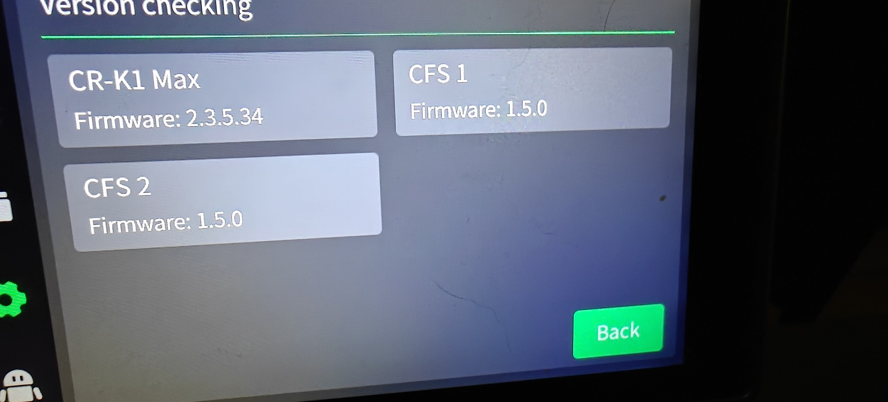
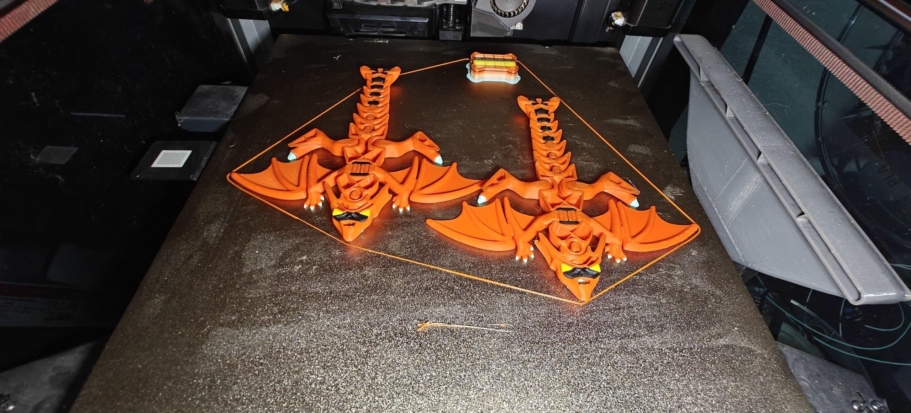
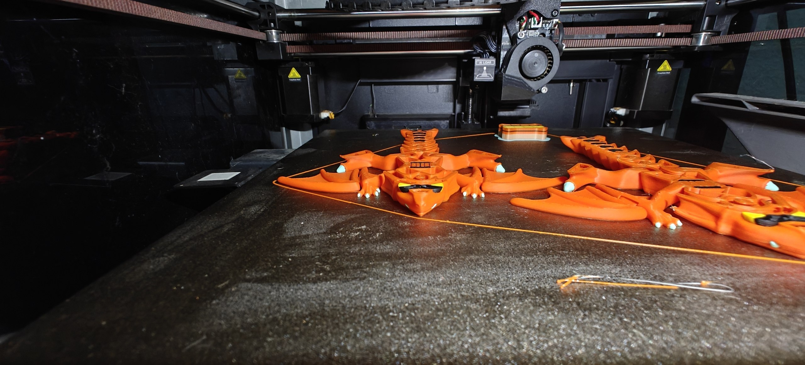
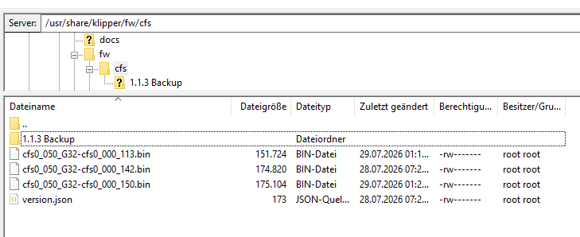
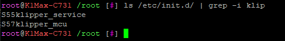
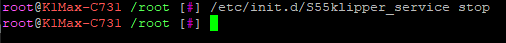
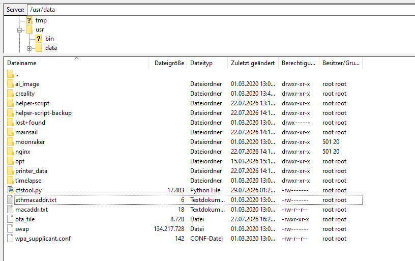
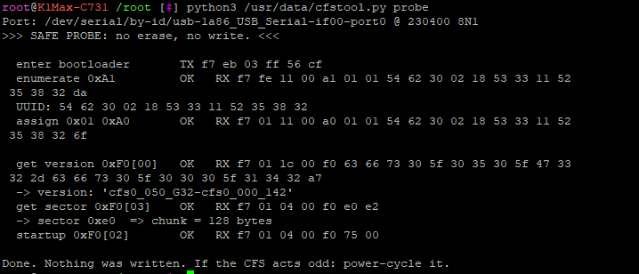

# cfstool — flash a Creality CFS from the printer, in pure Python

Talk to and **flash the firmware of a Creality CFS** (Creality Filament System)
directly from a **K1-series printer**, over its RS485 bus, using nothing but the
printer's own Python. No `mcu_util_485` binary required.

> **Why this exists:** on some K1-series printers the CFS firmware is meant to be
> flashed by `/usr/bin/mcu_util_485` over RS485 (see `/etc/init.d/S13mcu_update`),
> but that binary is **missing** from the firmware image. As a result the printer
> can talk to the CFS (versions, material handling) but can **never update it**, so
> an older CFS stays stuck on its factory version. The only `mcu_util_485` you can
> find elsewhere is built for a **different CPU architecture** (ARM) and won't run
> on the printer's MIPS CPU.
>
> `cfstool` re-implements the RS485 flash protocol in **pure, standard-library
> Python**, so it runs natively on the printer regardless of CPU — or on a Pi/PC.

---

## ⚠️ WARNING — READ THIS FIRST

**The `flash` command erases and rewrites the CFS microcontroller. Getting it
wrong can permanently damage (brick) the CFS board.**

- This is a **community-reconstructed** tool, **not** Creality's official flasher.
- **Always run a DRY RUN first** (that's the default) and check the output.
- Connect **exactly one** CFS. Stop Klipper so it doesn't fight for the bus.
- Keep power **rock-stable** during writing. Do not unplug or power off mid-flash.
- Use at your **own risk**. No warranty (see LICENSE).

Good news on recoverability: the erase step wipes only the **application** flash
region, **not the bootloader**. So an interrupted flash usually leaves the CFS in
its bootloader, and you can simply **run the flash again**. A true permanent brick
requires corrupting the bootloader region, which the normal flow never writes to.

---

## Proof — on the printer's own screen

The printer firmware stayed on **2.3.5.34** the whole time; only the CFS units were
upgraded, one at a time, straight from their factory versions.

**Before** — CFS 1 shipped on 1.1.3, CFS 2 (a refurb) on 1.4.2:



**After flashing CFS 1** — both on 1.4.2:



**After flashing both to 1.5.0** — printer still 2.3.5.34, both CFS on 1.5.0:



(The "Version checking" screen reads the **live** version from each CFS, so it
reflects the real on-CFS firmware — independent of `version.json`.)

And the CFS happily doing multi-color work after the update (colour changes on the
claws and faces — this doesn't *prove* anything about the flasher, the version screen
above does that, but it's the real-world result):




---

## Supported hardware

| Device | Bus | Naming | Supported? |
|---|---|---|---|
| **Original CFS, G32** | RS485 (CH340) | `cfs0_050_G32-…` | ✅ Tested (1.1.3 → 1.4.2 → 1.5.0 verified on real hardware) |
| **Original CFS, G30** | RS485 (CH340) | `cfs0_050_G30-…` | ⚠️ Untested — *should* work (same protocol; the G30/G32 firmware images were byte-identical), but nobody has confirmed it on G30 hardware yet |
| Any `cfs0` app version | RS485 (CH340) | `…cfs0_000_113/142/150/…` | ✅ Version-agnostic |
| **CFS "cfs6" generation** | — | `cfs6_100_G31 / cfs6_220_000` | ❌ No (different hardware; blocked by the tool) |
| **CFS-C** | CAN (`cmd_iap`) | — | ❌ No (different product & protocol) |

Only **G32** has actually been flashed and verified on real hardware (1.1.3 → 1.4.2
→ 1.5.0). G30 is expected to work but is **unconfirmed** — if you have a G30 CFS, a
dry run (`cfstool.py flash`) is safe and a report back would be very welcome.

**Confirmed printer models:** K1 Max (the author) and **K1C** (reported working by a
user). The flow should be the same on any K1-series printer whose CFS is on the CH340
RS485 adapter.

- Works on **K1-series printers** where the CFS is on the CH340 USB-RS485 adapter
  (VID `1a86`) — and in principle on any Linux host with that adapter (printer, Pi, PC).
- The tool **reads the connected CFS's hardware** (G30/G32) and **refuses a
  mismatched firmware file**, so you can't accidentally flash the wrong variant.
- **Multiple CFS units:** flash them one at a time, with **only one connected** at a
  time.

## Requirements

- A K1-series printer (or any Linux host) with **root shell access**.
- **Python 3** (standard library only — no pip installs).
- The CFS connected via its **USB-RS485 adapter** (CH340, VID `1a86`), which shows
  up as `/dev/serial/by-id/usb-1a86_USB_Serial-if00-port0` → `ttyUSB0`.
- The **firmware `.bin`** you want to flash. **Not included here** (it is Creality's
  copyrighted firmware). You already have it on your printer at
  `/usr/share/klipper/fw/cfs/`, or inside a newer official firmware image.

## Install

Copy `cfstool.py` onto the printer **to `/usr/data/`** (that folder survives reboots,
and all commands in this README use that path), then stop Klipper so the RS485 bus is
free:

```sh
# find and stop the klipper service (name varies)
ls /etc/init.d/ | grep -i klip
/etc/init.d/S55klipper_service stop
```

Connect **only one** CFS.

## Step-by-step (with screenshots)

**1. Your CFS firmware lives here on the printer** — `/usr/share/klipper/fw/cfs/`.
These `cfs0_050_G32-cfs0_000_*.bin` files are what gets flashed (keep a copy as a
backup; here an old `1.1.3 Backup` folder sits next to them).



**2. Find the Klipper service name** (it varies between firmware versions):



**3. Stop Klipper** so it doesn't use the RS485 bus while you talk to the CFS:



**4. Put `cfstool.py` on the printer** (e.g. in `/usr/data/`) with an SFTP client
such as FileZilla:



Now you're ready to run `query`, `diag`, `probe`, or `flash` (below). The commands
use the full path `/usr/data/cfstool.py`, so they work from any directory.

When you're done, start Klipper again: `/etc/init.d/S55klipper_service start`.

## Usage

> **All commands below use the full path** `/usr/data/cfstool.py`, so you can copy
> and paste them and they work **from any directory** — no `cd` needed. If you put
> the file somewhere else, just change `/usr/data/` to wherever it is.
>
> Always start with `python3`. (Plain `cfstool.py query` won't work — the file isn't
> on your PATH.)

### 1. `query` — read the CFS in APP mode (100% safe)

```sh
python3 /usr/data/cfstool.py query
```

Prints a comm test, the device identity/UUID, `GET_VERSION_SN`, and hardware
status. The **leading digits of the version string are the firmware version**
(e.g. `113…` = 1.1.3, `142…` = 1.4.2). This is the easiest way to check what a CFS
is running, before and after flashing.

### 1b. `diag` — a tidy diagnostic readout (100% safe)

```sh
python3 /usr/data/cfstool.py diag
```

Same idea as `query`, but formatted into labelled fields — communication, firmware,
serial number, UUID, hardware status, and RFID/filament per slot:

```text
  Kommunikation : OK (ACK)
  Firmware      : 1.5.0
  Seriennummer  : 10000854965B625BAJG
  UUID          : 54 62 30 02 18 53 33 11 52 35 38 32
  Hardware-Stat : 10 20 30 40 50 60 00 ...
  RFID/Slots    : A:...;B:none;...
```

It sends **only safe read commands**. The **hardware variant** (G30/G32) and
**bootloader** version come from `probe` (they need bootloader mode). Motor state and
environment sensors (temp/humidity, filament sensors) are **deliberately not queried**
— those commands aren't clean read-only in the protocol, and this tool never sends an
unverified command to the CFS.

### 2. `probe` — read in BOOTLOADER mode (safe, no write)

```sh
python3 /usr/data/cfstool.py probe
```

Enters the bootloader, enumerates + addresses the CFS, reads the bootloader version
and the flash sector size, then starts the app again. Writes nothing. Useful to
confirm bootloader access works before flashing.

Example output (a CFS reporting `cfs0_050_G32-cfs0_000_142`, sector `0xe0` → 128-byte
chunks):



### 3. `flash` — flash a firmware `.bin`

**Pick from a folder (recommended):** with no file given, `flash` scans the
printer's CFS firmware folder (`/usr/share/klipper/fw/cfs`), reads the connected
CFS's current version/hardware, lists the available firmware, and **then asks you
which version to install** (interactively). You don't put the filename on the
command line — you choose it from the menu. Incompatible files (wrong hardware,
e.g. G30 vs G32) are flagged and blocked.

```sh
# DRY RUN (default): scan, ask which version, validate - writes NOTHING
python3 /usr/data/cfstool.py flash
```

The command is just `flash`; the version choice happens at the prompt it shows:

```text
Scanned /usr/share/klipper/fw/cfs: found 3 firmware file(s).

Mode: DRY RUN (no erase/write)

  enter bootloader       TX f7 eb 03 ff 56 cf
  enumerate 0xA1         OK   RX ...
  assign 0x01 0xA0       OK   RX ...
  -> current version: 'cfs0_050_G32-cfs0_000_142'
  get sector 0xF0[03]    OK   RX ...
  -> sector 0xe0  => chunk = 128 bytes

Available firmware (connected CFS: hardware G32, version cfs0_050_G32-cfs0_000_142):

  ! [0] cfs0_050_G30-cfs0_000_142.bin   v1.4.2  <- WRONG HARDWARE (G30), do not pick
    [1] cfs0_050_G32-cfs0_000_142.bin   v1.4.2  <- already installed
    [2] cfs0_050_G32-cfs0_000_150.bin   v1.5.0

Which firmware to install? [number, or q to cancel]: 2

Selected: cfs0_050_G32-cfs0_000_150.bin  (v1.5.0)
  size: 175104 bytes
PLAN: 1.4.2  ->  1.5.0   (175104 bytes, 1368 frames of 128, last 128)

>>> DRY RUN complete. NOTHING was written.
>>> If the plan looks right, re-run with  --flash  to write.
```

**Real flash:** the exact same command **plus `--flash`**. It scans and asks the
same way, then actually writes:

```sh
python3 /usr/data/cfstool.py flash --flash
```

```text
...same scan + prompt...
Which firmware to install? [number, or q to cancel]: 2

Selected: cfs0_050_G32-cfs0_000_150.bin  (v1.5.0)
PLAN: 1.4.2  ->  1.5.0   (175104 bytes, 1368 frames of 128, last 128)

=== FLASH START - DO NOT POWER OFF ===
  erase 0xF0[06]         OK   RX f7 01 04 00 f0 75 00
  request 0xF0[01]       OK   RX f7 01 04 00 f0 75 00
  fw len 0xF0            OK   RX f7 01 04 00 f0 75 00
  -> sending 1368 frames ...
     50/1368 frames (6400/175104 bytes)
     100/1368 frames (12800/175104 bytes)
     ...
     1368/1368 frames (175104/175104 bytes)
  startup 0xF0[02]       OK   RX f7 01 04 00 f0 75 00
=== FLASH END ===

Verify with:  python3 /usr/data/cfstool.py query   (after power-cycling the CFS)
Look at GET_VERSION_SN - the leading digits are the version.
```

> **Power-cycle the CFS after the flash — this matters.** On at least some original
> G32 CFS units, right after a completed flash the CFS will **not** answer APP-mode
> `query`/`diag` commands, and the tool's own post-flash version read may come back
> empty — so the update can *look* like it failed when it actually succeeded.
> **Physically power the CFS off and back on** (only **after** `=== FLASH END ===`,
> never during the flash), then start Klipper again and confirm with `query`.
> (Reported by a user on a K1C, and matches the author's experience on a K1 Max.)

After it finishes, **power-cycle the CFS**, then confirm:

```sh
python3 /usr/data/cfstool.py query   # GET_VERSION_SN should now start with 150...
```

You can also skip the menu and point at a directory or a single file:

```sh
python3 /usr/data/cfstool.py flash /path/to/fw/dir            # scan that directory, then ask
python3 /usr/data/cfstool.py flash /usr/share/klipper/fw/cfs/cfs0_050_G32-cfs0_000_150.bin --flash   # one file, no menu
```

`cfstool` is **version-agnostic** — it flashes any `cfs0_…_<ver>.bin` (1.4.2, 1.5.0,
and future releases) with no code changes; it reads the target version from the
file and the current version from the CFS.

The dry run enumerates the CFS, reads its current version and sector size,
validates the file, and prints the plan — without touching flash. Safety gates
abort on a wrong-hardware file, on a file that isn't a CFS image, if the CFS
already runs that version, or if no single CFS is found.

During a real flash **do not power anything off** until you see `=== FLASH END ===`.

### Keeping the printer display in sync (`version.json`)

The printer shows the CFS version based on the `version.json` next to the firmware.
After a **real flash**, `cfstool` automatically keeps that file in sync — it **backs
up** the existing `version.json` (timestamped, e.g. `version.json.bak_2026-07-28_2325`)
and then sets the flashed hardware's entry to the new version. Other entries (e.g. a
`G30` block, or the newer `cfs6` block) are left untouched. In a dry run it only
**previews** the change and writes nothing.

Add `--no-json` if you don't want the file touched at all:

```sh
python3 /usr/data/cfstool.py flash --flash --no-json
```

This is purely cosmetic for the printer's UI; the actual firmware on the CFS is what
`query` reports and does not depend on `version.json`.
Then power-cycle the CFS and verify:

```sh
python3 /usr/data/cfstool.py query   # GET_VERSION_SN should now start with the new version
```

### Options

- `--dev <port>` — serial device (default
  `/dev/serial/by-id/usb-1a86_USB_Serial-if00-port0`).

## How it works

The CFS is an RS485 slave. The printer normally: (1) broadcasts an "enter
bootloader" frame, (2) enumerates the bus and assigns the CFS address `0x01`,
(3) drives an erase → request → length → data → startup sequence. `cfstool`
reproduces exactly this. See [`PROTOCOL.md`](PROTOCOL.md) for the wire format and
the full command sequence.

## Two layers: printer vs CFS (why this matters)

*(Observations from analysing the stock printer module and the CFS firmware — not
official docs.)* There are **two separate pieces of software**, and people often
confuse them:

- **Printer side** — a Klipper module (`[box]`, implemented in a compiled
  `box_wrapper*.so`) that exposes `BOX_*` G-code commands (e.g. `BOX_GET_RFID`,
  `BOX_EXTRUDE_MATERIAL`, `BOX_SET_PRE_LOADING`). Internally these call
  `communication_*` methods that send RS485 messages.
- **CFS side** — the firmware **on the CFS's own MCU** (the `.bin` this tool
  flashes), which receives those RS485 messages and runs the actual motor/RFID/
  feeding logic (`STATE_PRELOAD`, feeder start/stop, RFID read/write, …).

They map like a chain, they are **not** the same command set:

```text
G-code  BOX_SET_PRE_LOADING
  → printer:  BoxAction.communication_set_pre_loading
     → RS485 message on the bus
        → CFS firmware:  STATE_PRELOAD / feed process / feeder start
```

Consequences worth knowing:

- **A config or macro can only call `BOX_*` commands that the printer's compiled
  module already contains.** You can't add new commands (or port another model's
  features, e.g. the K2's filament *drying* commands) by editing a `.cfg` — that
  logic isn't in your printer's module, and the modules are model/CPU/Python
  specific (K1 Max = MIPS/py3.8, K2 = ARM/py3.9), so you can't just swap them.
- **CFS firmware updates change what the CFS does behind an unchanged interface.**
  The feeding/preload refinements in CFS 1.5.0 are *internal* to the CFS — the
  RS485 opcodes didn't change, so a stock printer still drives them fine. That's
  why flashing the CFS newer works without touching printer firmware.
- **Some features need both sides.** RFID (added in CFS 1.4.2) only works
  end-to-end because the printer also has `BOX_GET_RFID` to ask for it.

## FAQ

**Can I upgrade only the CFS and keep my printer firmware?**
Yes — that's exactly what this tool is for. The CFS runs its own firmware on its
own microcontroller; `cfstool` flashes that firmware over RS485 **without touching
the printer firmware**. (Demonstrated in practice: printer left on 2.3.5.34, both
CFS units taken from their factory versions up to 1.5.0 — see the photos above.)

**"Isn't the CFS firmware just a protocol bound to the printer, not stored on the CFS?"**
No. The CFS has its own **GD32F303 MCU running RT-Thread**, with the firmware stored
in its own flash. The `.bin` files are real ARM Cortex-M images (vector table, reset
handler, etc.). You can read the version straight off the CFS (`query`) and this tool
erases/writes that on-CFS flash. There *is* a version coupling — the printer bundles a
CFS firmware and normally force-flashes the CFS to match, and the RS485 feature set
must line up between versions — but that coupling exists because the printer *writes*
the CFS firmware, not because the CFS has none.

**Can I downgrade (flash an older version)?**
Yes. The flash is direction-agnostic — it erases the application region and writes
whichever `.bin` you pick, so an older version flashes exactly like a newer one; just
choose the lower version from the menu (or pass its file path). The only version gate
refuses re-flashing the version that is *already* installed. Two honest caveats:
upgrades are what has been verified on real hardware (1.1.3 → 1.4.2 → 1.5.0) — a
downgrade runs the identical flash path but hasn't been explicitly tested; and going
below a feature threshold changes behaviour (e.g. below 1.4.2 the CFS loses RFID
spool support, and the printer may then flag it as "needs update" even though the
flash itself succeeded).

**Do I need the `version.json` next to the firmware?**
No. `cfstool` reads the current version from the CFS and the target from the `.bin`
filename/contents. `version.json` is only used by the printer's own (here: missing)
auto-flash mechanism.

**Will it work for future versions / new CFS hardware?**
For `cfs0`-family boxes, yes — any `cfs0_…_<ver>.bin` works. Newer bundles have begun
listing a different `cfs6`-family hardware too; that is a separate device type and is
out of scope here (the tool blocks mismatched hardware).

## Acknowledgements & honest disclosure

I'll be upfront: **I'm not a programmer.** I don't really know how to code. This
tool was built **with the help of AI** (Anthropic's Claude and OpenAI's ChatGPT) —
the AI did the reverse-engineering of the stock `mcu_util_485`, worked out the RS485
flash protocol, and wrote the Python. What I brought was the printer and CFS
hardware, the goal, all the trial-and-error testing on real hardware, and the final
decisions (including hitting "flash").

So please read the code with that in mind, and **use it at your own risk**. Every
step was verified against the stock tool and confirmed on live hardware before it
was trusted — nothing here was guessed — but it is still a community-reconstructed
tool, not an official Creality one. Reviews, fixes, and improvements from people who
*do* know what they're doing are very welcome.

## Credits

- RS485 bus/command documentation cross-checked against the excellent
  **archworks.co** K2-Plus reverse-engineering write-up.
- The flash/bootloader sequence was derived by analyzing Creality's own
  `mcu_util_485` for interoperability. No Creality code or firmware is included.

## License

MIT — see [`LICENSE`](LICENSE). Provided **as is, without warranty**. You are
responsible for anything you flash.

## Disclaimer

This is an independent, community-built tool. It is **not affiliated with, authorized
by, or endorsed by Creality.** "Creality" and "CFS" are trademarks of their respective
owners and are used here only to describe compatibility. **No Creality firmware,
binaries, or other proprietary files are included in this repository** — you supply
your own firmware from your own device. The protocol notes were derived by observing
and analysing an existing device for interoperability. Use at your own risk.
